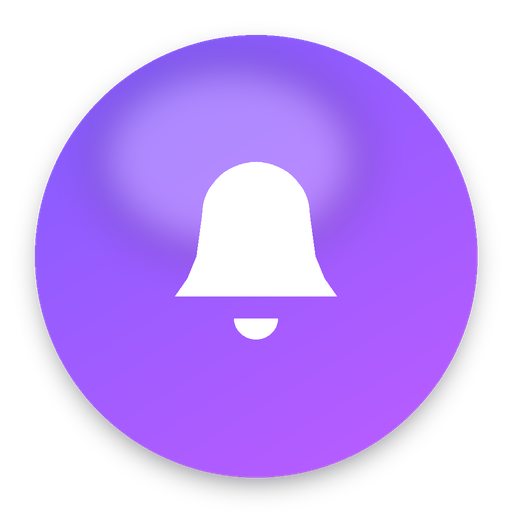
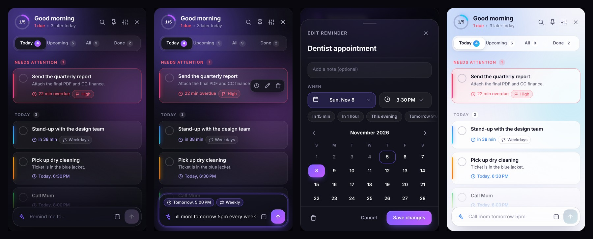
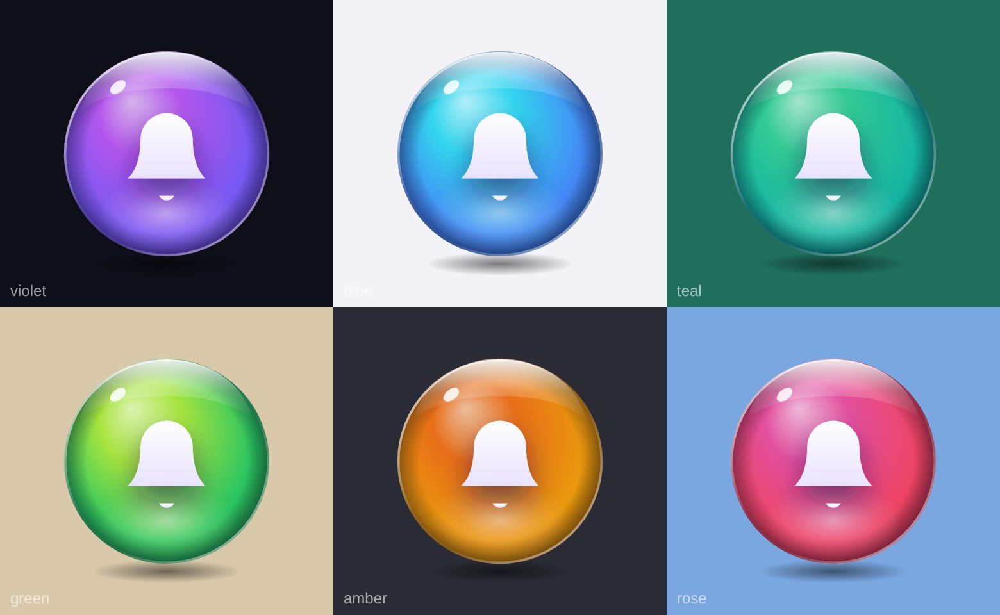

<p align="center"></p>

<h1 align="center">Reminder Bubble</h1>

<p align="center">A floating reminder bubble for Windows that stays on top of every window.<br>
Native <b>.NET 8</b> shell · <b>HTML / CSS / JS</b> interface · <b>SQLite</b> storage.</p>

<p align="center"></p>

<p align="center"></p>

## What it does

A small glowing bubble floats above all your windows. It tucks itself against the screen edge, pulses and rings when a
reminder is due, and opens a polished panel when you click it.

* **A 3D glass bubble, always on top** – a glossy glass sphere (it recolours with your accent) that is never hidden behind
  other apps. The highlight follows your pointer, and it springs when you press it.
* **Place it anywhere, any size** – drag it to any spot on any monitor and it stays exactly there. **Scroll over it** or drag
  the **grip** that appears on its corner to resize (40–160 px); right-click offers *Make bigger / smaller / Reset size*.
  Prefer an edge? Turn on *Snap to screen edge* (and *Tuck away when idle*) in Settings.
* **Due alerts** – the bell swings, pulse rings ripple, a badge counts what is due, a soft synthesised chime plays and a card
  slides out of the bubble with **Done** and **Snooze** (10 min by default, or pick 30 min / 1 h / tomorrow …).
* **Quick add in plain English** – type `call mom tomorrow 5pm`, `stand-up every weekday 9am`, `in 20 min stretch`,
  `dentist next friday 3pm`, `pay rent every month`. A live preview shows how it was understood; press Enter.
* **Full editor** – notes, custom calendar and time pickers, repeat (daily, weekdays, weekly, monthly, yearly), colour tags and
  priority.
* **Views** – Today / Upcoming / All / Done, search, a daily progress ring, undo for every destructive action.
* **Premium feel** – dark, light or follow-Windows theme, six accent colours, glass surfaces, spring animations, FLIP list
  transitions, hover spotlight, animated sheets and toasts. Honours *reduce motion*.
* **Also** – tray icon, single instance, start with Windows, bubble size / opacity, 12 / 24-hour clock.

Everything is stored locally in `%LOCALAPPDATA%\ReminderBubble\reminders.db`. Nothing leaves your PC.

## Install

**Requirements:** Windows 10 / 11 (x64). The app's UI runs on the
[WebView2 Runtime](https://developer.microsoft.com/microsoft-edge/webview2/) – already part of Windows 11 and current
Windows 10, and the installer downloads it for you if it is missing.

1. Run **`releases/ReminderBubble-Setup-1.1.2.exe`** (a small ~3 MB download; it fetches the .NET 8 Desktop Runtime and the
   WebView2 Runtime during setup only if they are missing). No internet on the target PC? Use
   `ReminderBubble-Setup-1.1.2-offline.exe` (~60 MB, everything bundled) from [Actions](../../actions) / [releases](../../releases).
2. Next → Next → Install. No administrator rights are needed: it installs for your user into
   `%LOCALAPPDATA%\Programs\Reminder Bubble` (choose *all users* on the first page if you prefer Program Files).
3. Optional checkboxes: **start with Windows** and a **desktop shortcut**. Then tick *Launch Reminder Bubble*.

Upgrading is the same: run the newer setup over the old one (your reminders are kept). Uninstall from
*Settings → Apps*; it asks whether to delete your reminders too.

Prefer no installer? `dist\ReminderBubble-win-x64.zip` (from `build.ps1` / the Actions artifact) is a portable copy:
unzip and start `ReminderBubble.exe`, keeping the `wwwroot` folder next to it.

## Using it

* The open panel follows the bubble when you move or resize it
* Click the bubble – open / close the panel · drag it – move it anywhere · scroll or drag its corner grip – resize ·
  right-click – menu
* Tray icon: click to open, right-click for the menu (hide bubble, settings, quit)
* In the panel: `N` new reminder, `/` search, `1`–`4` switch view, `Esc` close

## Build from source

Install the [.NET 8 SDK](https://dotnet.microsoft.com/download/dotnet/8.0), then:

```powershell
.\build.ps1            # tests + publish -> dist\ReminderBubble-win-x64.zip and dist\ReminderBubble-Setup-<version>.exe
.\build.ps1 -Run       # ... and launch it
```

The installer is an [Inno Setup 6](https://jrsoftware.org/isinfo.php) script (`installer/ReminderBubble.iss`);
`winget install JRSoftware.InnoSetup` once and `build.ps1` compiles it for you. Pushing a tag like `v1.0.1` makes
GitHub Actions build the installer and attach it to a release.

or just `dotnet run --project src/ReminderBubble` while developing. Set `RB_DEVTOOLS=1` to enable the WebView2 developer
tools (F12 / right-click → Inspect).

## How it is put together

```
src/ReminderBubble/
  Program.cs, App.cs            start-up, single instance, scheduler tick, window placement
  Windows/BubbleWindow.cs       the floating glass bubble: transparent WPF window, drag anywhere, resize, optional edge snap, pulse, badge
  Windows/WebHostWindow.cs      borderless WebView2 window used for the panel and the alert popup
  Windows/TrayIcon.cs           notification-area icon + dark menu
  Services/                     ReminderService (CRUD + scheduler), Recurrence, SettingsService, WebBridge, Chime ...
  Data/Database.cs              SQLite schema + helpers (Microsoft.Data.Sqlite)
  wwwroot/                      the UI: index.html (panel), alert.html, css/, js/
docs/bubble.svg, tools/bubble_svg.py   the glass-sphere design (source of the icon and installer art)
installer/                    Inno Setup script + wizard artwork
releases/                     the built installer, for convenience
tests/ReminderBubble.Tests      xUnit: database, scheduler, recurrence, settings (runs on any OS)
tests/ui                        parser tests + browser flow tests (Playwright) against the mock backend
```

* The shell is **code-only WPF** (no XAML). The bubble is a native layered window so it can be truly round, glow and
  spring; the panel and alert are WebView2 windows that load `wwwroot` from a virtual host (`https://app.reminderbubble/`),
  so the app works offline and no port is opened.
* JS talks to C# through a small request/response bridge over `chrome.webview.postMessage`
  (`reminders.add`, `reminders.complete`, `settings.patch`, …). The host pushes events (`changed`, `settings`, `shown`) back.
* The scheduler is a 1-second `DispatcherTimer`. Reminders that came due while the app was closed fire at start-up.
  Repeating reminders step in **local** time, so "every day at 9:00" stays at 9:00 across daylight-saving changes.
* `wwwroot/js/mock.js` is a localStorage stand-in for the host: open `wwwroot/index.html` through any static server to
  work on the UI in a normal browser.

```powershell
cd tests/ui; npm install; npx playwright install chromium; npm test     # UI tests
dotnet test                                                             # C# tests
```

## Troubleshooting

* Logs: `%LOCALAPPDATA%\ReminderBubble\log.txt`
* Reset everything: quit the app and delete `%LOCALAPPDATA%\ReminderBubble`.
* Bubble not visible? Tray icon → *Show bubble*.
